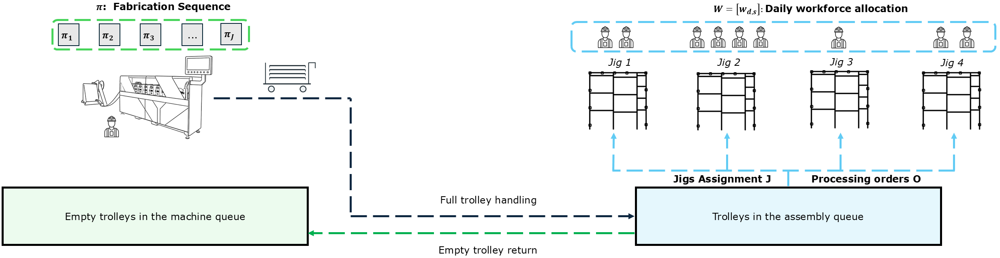
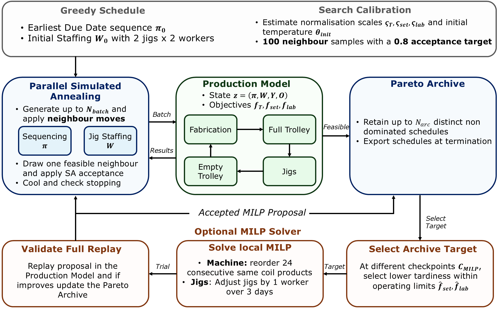

# Off-site construction problem

This repository addresses integrated production scheduling in a labour-intensive
off-site construction factory. Fabrication, assembly and internal material
transport share resources and constrain one another: a fabrication sequence can
only support delivery commitments when assembly capacity, worker availability and
trolley circulation are considered together.



*Figure 1. Coupled fabrication, internal logistics and assembly. The fabrication
sequence determines the order in which products enter the system, while daily
workforce allocation determines the capacity available at each assembly jig.
Loaded trolleys move products downstream, and empty trolleys return for reuse.
The four jigs shown illustrate the system; the number of jigs is configurable.*

## Production system and material flow

A single fabrication machine processes products one at a time. Each product has
a coil family, a fabrication duration, handling and assembly workloads, and a
production deadline. Changing coil family between consecutive products requires
a machine setup; the first product requires no setup. Consecutive products form
trolley batches limited by the carrier capacity, with a final partial batch
allowed.

An empty trolley must be available before fabrication of a batch begins. If the
finite fleet is fully occupied downstream, fabrication waits for a trolley to
return. After the batch is fabricated, the machine operator delivers its loaded
trolley to the assembly queue. Products become available for handling when the
trolley arrives, but fabrication remains suspended until the operator returns.

Products are assigned to parallel assembly jigs. At each jig, workers first unload
and position a product's components, then complete its assembly before starting
the next product in the committed processing order. Handling work depends on stud
count, while assembly work depends on screw count. Processing follows working-day
shift calendars and can pause across shifts, weekends and unstaffed days without
losing completed work or changing the product's position.

## Workforce allocation and trolley returns

The number of workers assigned to each jig can vary by day. Workers collaborate
on the current product, with additional workers providing diminishing productivity
gains under the default productivity model. An unstaffed jig has no processing
capacity. Staffing is bounded per jig; the current formulation does not impose an
additional factory-wide workforce limit.

A trolley becomes empty as soon as handling finishes for every product it carries,
even if assembly is still underway. One worker from the jig completing the final
handling operation returns the trolley to the machine area and then walks back.
The trolley is available for reuse upon arrival at the machine, while the worker
remains unavailable for the complete round trip. That absence reduces the jig's
processing rate or temporarily stops work if no other worker remains. Transport
duties must fit within the relevant working shift.

This creates a feedback loop: staffing affects unloading and trolley release;
trolley availability affects fabrication; and transport duties reduce the capacity
available for subsequent assembly.

## Scheduling decisions

The optimiser directly controls two decisions:

| Decision | Representation | Role |
| --- | --- | --- |
| Fabrication sequence | $\pi$ | A permutation defining the order in which every product is fabricated. |
| Daily workforce allocation | $W = [w_{d,s}]$ | The integer number of workers assigned to jig $s$ on calendar day $d$. |

Jig assignments, labelled **J** in the figure, and per-jig processing orders,
labelled **O**, are associated schedule attributes rather than independent search
variables. The production model derives or retains them according to the selected
neighbourhood move, then evaluates the resulting fabrication, handling, transport
and assembly timings together.

## Objectives and solution approach

Feasible schedules are compared against three objectives, all minimised:

| Objective | Definition |
| --- | --- |
| Total tardiness | Sum of each product's positive delay between final assembly completion and its deadline. Elapsed delays include nights and weekends. |
| Labour cost | Cost of complete paid machine-crew and assigned jig-worker shifts through their respective completion cutoffs, including idle time and transport duties. |
| Machine setup duration | Total productive setup time caused by coil-family changes in the fabrication sequence, excluding waiting, transport and non-working periods. |

These objectives can conflict: grouping products by coil family reduces setups,
while delivery priorities may favour a different sequence, and additional staffing
can increase capacity at a higher labour cost. The optimiser therefore retains a
Pareto archive of non-dominated schedules representing alternative trade-offs.

Parallel simulated annealing explores fabrication-sequence and workforce changes.
Optional mixed-integer linear programming (MILP) refines selected machine
subsequences or jig staffing decisions. Every MILP proposal is replayed through
the full production model before acceptance so that trolley availability, worker
absences and shift boundaries remain part of the feasibility and performance
assessment.

## Framework



*Figure 2. Hybrid scheduling framework. The main stages are summarised below.*

- **Initialisation:** Build an earliest-due-date schedule with two jigs staffed by two workers each. Use 100 neighbour samples to calibrate objective scales and an initial temperature targeting 80% acceptance of typical dominated moves.
- **Parallel Simulated Annealing:** Explore fabrication-sequence and daily staffing changes through parallel neighbour evaluations, applying SA acceptance, temperature cooling and stopping criteria.
- **Production Model:** Simulate fabrication, trolley circulation and jig assembly with shift calendars and worker absences, checking feasibility and calculating tardiness, setup duration and labour cost.
- **Pareto Archive:** Retain distinct non-dominated schedules representing delivery, setup and labour-cost trade-offs, and export them when the search ends.
- **Optional MILP solver:** Refine an eligible archived schedule through local sequencing or staffing changes. Validate proposals through the full production model before updating the archive and current SA schedule.

## Getting started

1. Clone the repository, or open your existing local copy:

   ```sh
   git clone https://github.com/asbaragli10/offsite-scheduling.git
   cd offsite-scheduling
   ```

2. Create a Python environment and install the dependencies using the
   [Install](#install) instructions below. Install the hybrid requirements if you
   want MILP refinement.
3. Prepare your own product CSV using the [Input format](#input-format). No input
   datasets or previous results are included.
4. Set the placeholders in `scheduling_engine/paths.py`, or provide both paths
   explicitly when running:

   ```sh
   python main.py --data "PATH_TO_INPUT_CSV" --output-dir "PATH_TO_OUTPUT_DIRECTORY"
   ```

5. Inspect the schedules and KPIs in the new run subdirectory under your chosen
   output directory. Use `python main.py --help` to explore the available settings.

## Install

Use Python 3.11 or newer; the original requirements were tested on Python 3.12.
From this directory:

```sh
python -m venv .venv
```

Activate the environment (`.venv\Scripts\Activate.ps1` in PowerShell, or
`source .venv/bin/activate` on Linux/macOS), then install:

```sh
python -m pip install -r requirements.txt
```

For optional MILP refinement:

```sh
python -m pip install -r requirements-hybrid.txt
```

## Configure input and output paths

No input datasets, previous outputs, fitted distributions or calibration files are
included. The input CSV reader and result writers remain functional.

Edit these placeholders in `scheduling_engine/paths.py`:

```python
INPUT_CSV = Path("path/to/input/products.csv")
OUTPUT_DIRECTORY = Path("path/to/output")
```

Alternatively, supply both paths on each invocation:

```sh
python main.py --data "PATH_TO_INPUT_CSV" --output-dir "PATH_TO_OUTPUT_DIRECTORY"
```

Replace the uppercase examples with actual paths. Relative paths are resolved
from the current working directory. Unedited default placeholders are rejected
before any input is read or output directory is created.

## Input format

The CSV must contain the following columns:

| Column | Meaning |
| --- | --- |
| Unique Identifier | Unique product identifier |
| Coil Size | Non-negative integer identifying the coil/setup family |
| Machine Work Time | Positive fabrication duration, in seconds by default |
| Screws | Non-negative integer assembly-work quantity |
| Studs | Non-negative integer handling-work quantity |
| Production Deadline | Product deadline; use YYYY-MM-DD |

Set `--machine-work-time-unit minutes` or `hours` when needed. Without
`--start-date YYYY-MM-DD`, the production start is inferred as seven calendar days
before the earliest deadline; `--start-offset-days` changes that offset.

## Run

Use `python main.py --help` to inspect all model and search settings.

```sh
python main.py --data "PATH_TO_INPUT_CSV" --output-dir "PATH_TO_OUTPUT_DIRECTORY" --move-config 3 --seed 42 --workers 1
```

For hybrid simulated annealing and MILP:

```sh
python main.py --data "PATH_TO_INPUT_CSV" --output-dir "PATH_TO_OUTPUT_DIRECTORY" --milp-mode both
```

MILP modes are `none`, `machine`, `jigs` and `both`. The original resource and
search defaults are retained. In particular, MILP archive selection defaults to
setup durations of 3,600-14,400 seconds and labour costs of 39,000-42,000; adjust
`--milp-setup-min-seconds`, `--milp-setup-max-seconds`, `--milp-labour-min` and
`--milp-labour-cap` for your instance, otherwise checkpoints may be skipped.

Each run creates a unique subdirectory under your configured output root with
Pareto schedules, staffing plans, KPIs, logs, calibration and a source snapshot.
Future runs also export a portable copy of the selected input for reproducibility.
Calibration is computed from your own dataset unless you explicitly provide
`--calibration-file`. Keep inputs and generated results outside version control;
common local data/output locations and tabular data files are ignored.

## Code layout

- `main.py`: optimiser entry point.
- `scheduling_engine/paths.py`: input/output placeholders.
- `scheduling_engine/model/`: coupled fabrication, trolley and assembly simulation.
- `scheduling_engine/neighbourhoods/`: sequencing and workforce search moves.
- `scheduling_engine/optimisation/`: Pareto annealing, archive and MILP integration.
- `scheduling_engine/data/`: CSV loading and validation code, with no datasets.
- `scheduling_engine/reporting/`: schedule exports, KPIs and provenance.
- `MILP_post_processing/{machine,jigs}/`: MILP solvers used by the optimiser.
- `tests/`: portable hybrid integration checks.

Paper-specific campaigns, remote deployment scripts, input data and previous
results are excluded from this standalone copy.

## Checks

After installing the hybrid requirements:

```sh
python -m unittest discover -s tests -v
python -m unittest MILP_post_processing.machine.test_milp_neighborhood -v
```

These checks use small synthetic in-memory instances and require no case-study data.
